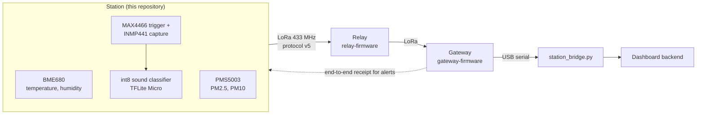
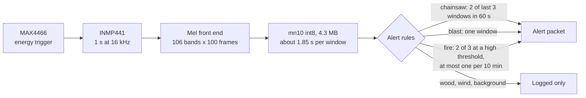
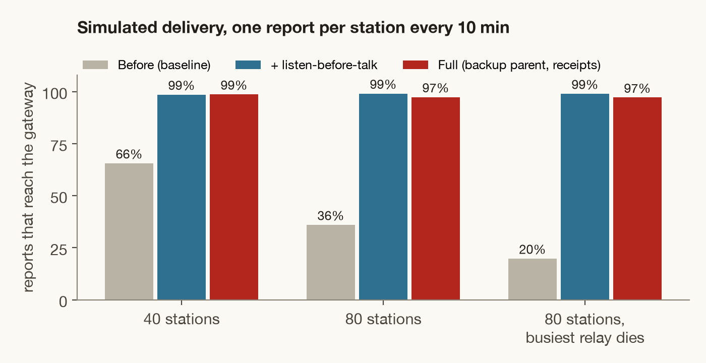

<div align="center">

# TerraWatch station firmware

**A lookout station on a forest ridge: it smells smoke, listens for chainsaws, and passes the word from station to station over LoRa.**<br>
ESP32-S3 with an SX1278 radio at 433 MHz, a BME680, a PMS5003 and two microphones.

[Architecture](ARCHITECTURE.md) &nbsp;·&nbsp; [Network simulation](simulations/multihop/README.md) &nbsp;·&nbsp; [Relay](https://github.com/Terra-Watch/relay-firmware) &nbsp;·&nbsp; [Gateway](https://github.com/Terra-Watch/gateway-firmware) &nbsp;·&nbsp; [Sound model](https://github.com/Terra-Watch/acoustic-ml) &nbsp;·&nbsp; [Hardware test guide](https://github.com/Terra-Watch/relay-firmware/blob/main/TESTING.md)


</div>



---

## What a station sends

| Packet | Tag | Size | When | Content |
|---|---|---|---|---|
| **Air quality and weather** | `S` | 15 bytes | Every 15 s | BME680 temperature and humidity; PM2.5 and PM10 from the PMS5003 (0xFFFF when the sensor is absent) |
| **Position** | `P` | | At start and every 10 min | The fixed position set at install (`TW_STATION_LAT_E6`, `TW_STATION_LON_E6`). The station has no GPS |
| **Sound alert** | `A` | 4 bytes | When the rules fire | Kind (chainsaw, blast, fire) and confidence in percent |

Telemetry is never resent; the next reading replaces it. An alert is resent until the gateway's receipt arrives.

## Listening



The model comes from [acoustic-ml](https://github.com/Terra-Watch/acoustic-ml) and is embedded from `model/`. It needs the `node-acoustic` build (octal PSRAM, a 6 MB app partition). Other builds run the trigger only, and `-D TW_ACOUSTIC=0` switches sound off.

**The thresholds are starting points. They have not been calibrated in a forest.**

## The radio link: protocol v5

A 12-byte header, up to 48 bytes of payload, and a CRC-16.

| Byte | 0 | 1 | 2 | 3 | 4 | 5 | 6-7 | 8 | 9 | 10 | 11 |
|---|---|---|---|---|---|---|---|---|---|---|---|
| **Field** | Preamble `0xA5` | Version `5` | Type | Source | Destination | Previous hop | Sequence | TTL | Hop count | Payload size | Next hop |

Packet types: `1` data, `2` heartbeat, `3` acknowledgement, `4` heartbeat ack, `5` route advertisement, `6` end-to-end receipt.

| Mechanism | What it does |
|---|---|
| Hop-by-hop ack | Each hop acknowledges; 3 tries before the link is declared failed |
| Listen-before-talk | A random delay, then a channel check with exponential back-off |
| Neighbour table | RSSI and SNR over a rolling window; stale neighbours expire |
| Routes | Static and learned routes, route advertisements, failure recovery |
| Backup parent | Takes over on retry, without waiting for a new route |
| Store and forward | A node holds packets while it has no route |
| End-to-end receipt | The gateway confirms each alert to its origin; the origin resends until it does |
| TTL and hop count | Stop loops |

There is **no authentication yet**. A truncated HMAC is planned.

## Does multi-hop hold up? A simulation

<div align="center">

</div>

`simulations/multihop/mesh_sim.py` simulates up to 80 stations reporting to one gateway (path loss with shadowing and fading, capture, half-duplex radios, the firmware's 8-packet queue), 6 seeds of 2 simulated hours each.

- Listen-before-talk is the step that matters: delivery at 80 stations goes from 36% to 99%.
- When the relay carrying the most stations dies half way, 97 to 99% of reports still arrive.
- Hop retries per packet fall from 23.4 to 1.1, and the channel is busy 22% of the time instead of 61%.
- One report per minute is too much for one gateway: past about 20 stations at that rate the answer is a second gateway.

The radio parameters are plausible for 433 MHz under canopy, **not measured**. Measure real link ranges before quoting a station count. Details: [`simulations/multihop/README.md`](simulations/multihop/README.md).

## Wiring (ESP32-S3 defaults)

| Part | Signal | GPIO |
|---|---|---|
| **SX1278** | SCK / MISO / MOSI | 12 / 13 / 11 |
| | CS / RST / DIO0 | 10 / 9 / 14 |
| **BME680** (I2C) | SDA / SCL | 17 / 18 |
| **PMS5003** | ESP RX (to sensor TXD) / ESP TX (to sensor RXD) / SET | 16 / 15 / 21 |

Defaults are in [`include/Config.h`](include/Config.h); another board overrides the radio pins with `-D TW_LORA_*`. GPIO 20 is USB D+ on the S3, so it is not used for I2C. The radio is 3.3 V only: fit the 433 MHz antenna before transmitting.

**Status LED** (`TW_LED_PIN`): blue air quality sent, red chainsaw, magenta blast, orange fire, white position.

## Build and test

```bash
pio run                                # ESP32-S3 dev board, no sound model
pio run -e node-acoustic               # ESP32-S3 N16R8 with the sound classifier
bash test/run_protocol_tests.sh        # host tests: one script per test in test/
```

Set your own upload port in `platformio.ini`. The `node-acoustic` build logs on the UART USB port at 921600 baud; slower logging corrupts radio reception on these boards.

To test on real boards with a relay and a gateway, follow the [hardware test guide](https://github.com/Terra-Watch/relay-firmware/blob/main/TESTING.md).

## Status

| | |
|---|---|
| Host tests | 12 of 14 scripts pass (run 2026-11-05). `run_reliability_tests.sh` and `run_failure_recovery_tests.sh` abort and have not been investigated |
| Sound classifier on the chip | Runs: about 1.85 s per one-second window |
| Over the air | Not range-tested in a forest |
| Authentication | Not built |

## Layout

| Path | Content |
|---|---|
| `src/` | Composition root and app loop |
| `lib/` | One folder per module: Acoustic, Sensors, Telemetry, HAL, LoRaDriver, Protocol, PacketFactory, PacketQueue, Neighbor, Routing, Forwarding, ReliableLink, Services, EventBus, Utils |
| `include/` | Config and constants |
| `model/` | The int8 sound model |
| `test/` | Host tests: protocol, fuzzing, routing, route recovery, store and forward, alert logic |
| `simulations/multihop/` | The network simulation and its results |
| `ARCHITECTURE.md`, `ARCHITECTURE_REVIEW.md`, `NETWORK_SERVICES_REVIEW.md` | Design notes |

---

<sub>Part of <a href="https://github.com/Terra-Watch">TerraWatch</a>: <a href="https://github.com/Terra-Watch/relay-firmware">relay</a> · <a href="https://github.com/Terra-Watch/gateway-firmware">gateway</a> · <a href="https://github.com/Terra-Watch/acoustic-ml">sound classifier</a> · <a href="https://github.com/Terra-Watch/dashboard">dashboard</a></sub>
